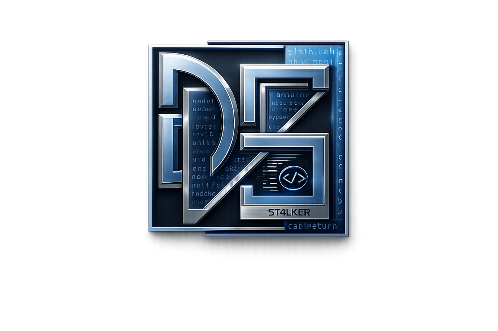

# DvS Web



> **Transformando ideias em experiências digitais.**

A DvS Web desenvolve soluções digitais personalizadas, combinando tecnologia,
criatividade e inovação para transformar ideias em projetos reais.

## Serviços

- **Bots para Discord:** sistemas personalizados, automações e ferramentas para
  otimizar a gestão de servidores.
- **Desenvolvimento Web:** websites, landing pages e interfaces modernas para
  fortalecer a presença digital.

## Sobre este repositório

Este repositório contém o site da DvS Web, desenvolvido com React. O projeto
também inclui integrações e recursos de atendimento; consulte a
[documentação do backend](./backend/README.md) para detalhes da API.

Site: [dvsweb.com.br](https://dvsweb.com.br)

## Executar localmente

Requisitos: Node.js e npm.

```bash
npm install
npm start
```

O servidor de desenvolvimento inicia em `http://localhost:3000`.

Para gerar a versão de produção:

```bash
npm run build
```

## Configuração do painel

Configure as variáveis do Firebase Authentication usando `.env.example` como
referência e habilite o provedor **E-mail/senha** no Firebase Console.

Para criar um usuário do painel, na pasta `backend`, execute:

```bash
npm run user:create -- "usuario" "uma-senha-segura" "Nome do usuário" "Administrador"
```

Configure a conta de serviço Firebase Admin em `backend/config/firebase.json`
localmente. Não versione credenciais ou segredos no repositório.

## Prévia ao compartilhar o site

O título e a descrição da prévia são definidos pelas tags Open Graph em
`public/index.html`. A imagem usada é `public/og-image.png`; para substituí-la,
atualize também a URL `og:image` no mesmo arquivo. As plataformas sociais podem
manter a prévia em cache após uma publicação.

## Contato

- **E-mail:** [deivisonsoares1610@outlook.com](mailto:deivisonsoares1610@outlook.com)
- **LinkedIn:** [Deivison Soares](https://www.linkedin.com/in/deivsoares-dev/)
- **GitHub:** [DeivSoares](https://github.com/DeivSoares)
